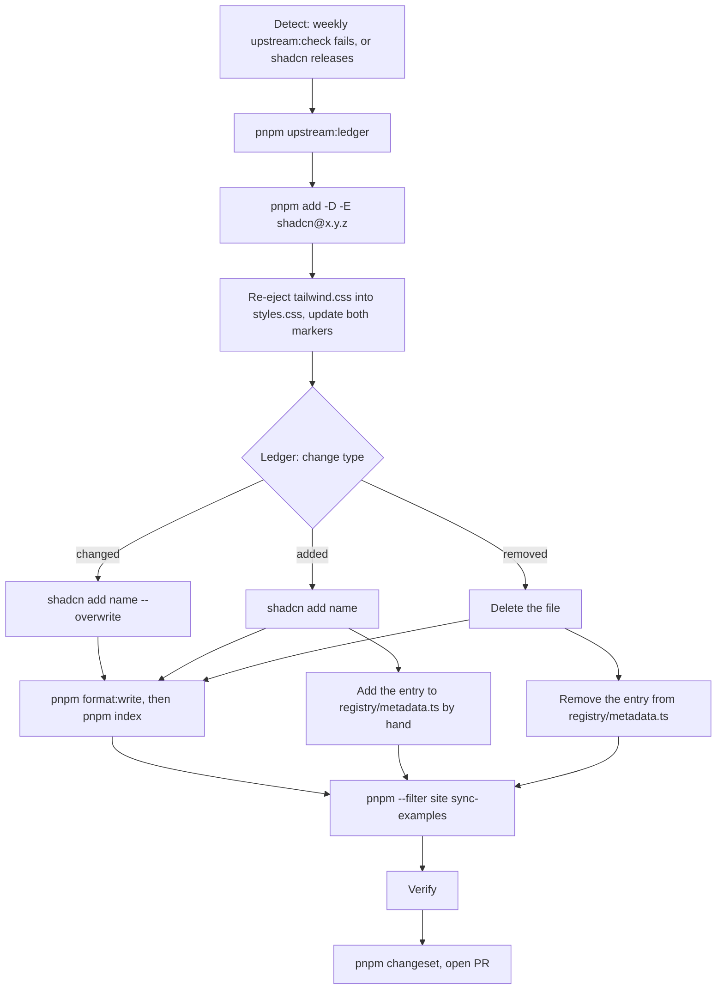

# @asif-sirajudeen/earth-ui

shadcn-based React components built on Base UI, shipped as a versioned package. It covers every component in shadcn's `base-nova` style.

## Install

```sh
pnpm add @asif-sirajudeen/earth-ui
```

Peer dependencies: `react` 19, `react-dom` 19 and `tailwindcss` 4.

## CSS setup

In your global stylesheet, import Tailwind **first**, then the package stylesheet:

```css
@import "tailwindcss";
@import "@asif-sirajudeen/earth-ui/styles.css";
```

The package stylesheet does not import Tailwind itself. It adds the theme tokens and tells Tailwind to scan the package's built components for classes.

## Usage

Import from the package root:

```tsx
import { Button, Input, Label } from "@asif-sirajudeen/earth-ui";

export function SignupForm() {
  return (
    <form className="grid gap-2">
      <Label htmlFor="email">Email</Label>
      <Input id="email" type="email" placeholder="you@example.com" />
      <Button type="submit">Sign up</Button>
    </form>
  );
}
```

Or import one component from its subpath:

```tsx
import { Button } from "@asif-sirajudeen/earth-ui/button";
import { Input } from "@asif-sirajudeen/earth-ui/input";
import { Label } from "@asif-sirajudeen/earth-ui/label";
```

Style a link as a button with `buttonVariants`:

```tsx
import Link from "next/link";
import { buttonVariants } from "@asif-sirajudeen/earth-ui";

<Link href="/docs" className={buttonVariants({ variant: "outline" })}>
  Docs
</Link>;
```

## Optional subpaths

Two modules are not exported from the package root and need peer dependencies that you install yourself:

| Subpath | Exports | Install |
| --- | --- | --- |
| `@asif-sirajudeen/earth-ui/sonner` | Sonner's `Toaster` | `sonner` and `next-themes` |
| `@asif-sirajudeen/earth-ui/use-highlighted-code` | `useHighlightedCode` (syntax highlighting for Code Block) | `shiki` |

The root `Toaster` is Base UI Toast's. Use the Sonner one only if your app already uses sonner. Call `toast()` from your own `sonner` import, and mount the `next-themes` provider yourself.

## Dark mode

Dark styles apply under a `.dark` class on an ancestor, usually `<html>`. With [next-themes](https://github.com/pacocoursey/next-themes), use `attribute="class"` and add `suppressHydrationWarning` to `<html>`:

```tsx
import { ThemeProvider } from "next-themes";

export default function RootLayout({ children }: { children: React.ReactNode }) {
  return (
    <html lang="en" suppressHydrationWarning>
      <body>
        <ThemeProvider attribute="class">{children}</ThemeProvider>
      </body>
    </html>
  );
}
```

## Look up components with the CLI

The package ships an `earth-ui` command. It answers from the installed version and works offline. Every command prints JSON.

```sh
npx @asif-sirajudeen/earth-ui list
npx @asif-sirajudeen/earth-ui search modal --limit 5
npx @asif-sirajudeen/earth-ui docs dialog
npx @asif-sirajudeen/earth-ui source dialog
npx @asif-sirajudeen/earth-ui help
```

- `list` prints every component with its title, description and import path.
- `search <query>` ranks components by name, title, description and exported names.
- `docs <name>` prints the import path, exported parts, variants and dependencies. For components built on Base UI, it also prints the props tables from the Base UI docs that ship with the installed `@base-ui/react`.
- `source <name>` prints the component's TSX source. Read it to see how a component is built; import the component from the package, do not copy it. `@/` imports in the source name other earth-ui modules, such as `@/components/button`.
- `help` (or `--help`, `-h`) lists the commands with usage and an example.

In a project that has the package installed, `pnpm exec earth-ui` and `npm exec earth-ui` also work. Do not run `npx earth-ui` without the scope: that name belongs to a different npm package.

### For AI coding agents

Add this block to your project's `AGENTS.md` (or `CLAUDE.md`):

````md
## earth-ui

UI components come from the `@asif-sirajudeen/earth-ui` npm package. Import them from the package. Do not copy component source into the project and do not run `shadcn add`.

Look components up with the `earth-ui` CLI before you write UI. It reads the installed version and works offline. Every command prints JSON.

```sh
npx @asif-sirajudeen/earth-ui search <need>     # find components, e.g. search modal
npx @asif-sirajudeen/earth-ui docs <name>       # import path, parts, variants, props
npx @asif-sirajudeen/earth-ui source <name>     # TSX source, to see how it is built
npx @asif-sirajudeen/earth-ui list              # every component
npx @asif-sirajudeen/earth-ui help              # all commands
```

Steps:

1. Run `search` with what you need. Pick the best match.
2. Run `docs <name>`. Use its `import` path and its `exports` (the parts). Use only the `variants` it lists. Use `props` for the props of each part.
3. Run `source <name>` only to see how a component is built.

Always use the scoped command `npx @asif-sirajudeen/earth-ui`. The unscoped `npx earth-ui` runs a different npm package.
````

The same block is in [`cli/README.md`](./cli/README.md).

## Install with the shadcn CLI

The components are also published as a shadcn registry under the `@earth-ui` namespace. Use it to copy the source into your project instead of installing the npm package.

> The registry is not hosted yet. The URL below is a placeholder until it is.

1. Add the namespace to your `components.json`:

   ```json
   {
     "registries": {
       "@earth-ui": "https://<registry-host>/r/{name}.json"
     }
   }
   ```

2. Add components:

   ```sh
   npx shadcn@latest add @earth-ui/button
   ```

Every component depends on `@earth-ui/style`, which installs the first time you add one. It adds the theme tokens, the `dark` variant and the base layer to your CSS file, together with `tw-animate-css` and `shadcn/tailwind.css`.

To update a component, review the changes first, then overwrite your copy:

```sh
npx shadcn@latest add @earth-ui/button --diff
npx shadcn@latest add @earth-ui/button --overwrite
```

`--overwrite` replaces your local edits to that file.

Always use the `@earth-ui/` prefix. A bare name such as `button` installs the official shadcn component, not the Earth UI one.

## Maintainers: upgrading shadcn

This section is for people and agents who work on this repo. It is not for package consumers.

earth-ui pins one shadcn version: `devDependencies.shadcn` in `package.json`. The components in `src/components`, the ejected block in `styles.css` and the examples in `site/examples` must all match that version. Checks fail when they do not.



### Steps

1. **Detect.** The `Upstream check` workflow runs `pnpm upstream:check` every Monday. It compares `src/` with what `shadcn add` installs today, after formatting both with our Prettier config, and fails on any real difference. It checks only the items we already have. New upstream components appear only in the ledger (step 2).
2. **See what changed.** Run the ledger before you change the pin, because it reads the starting version from `devDependencies.shadcn`. It needs the network and a logged-in `gh`.

   ```sh
   pnpm upstream:ledger            # from the pinned version to the latest shadcn@* tag
   pnpm upstream:ledger 4.24.0     # to a specific version
   pnpm upstream:ledger 4.23.0 --from 4.21.5   # any past range
   ```

   The ledger tracks only upstream components, not upstream hooks or libs. A component can bring a new hook or lib with it (in 4.22.0, `code-block` brought `use-highlighted-code` and `lib/highlighter`). After each `shadcn add`, run `git status` and look for new files there.

   The ledger lists, per release: added, changed and removed components; `cn-*` rule changes in `style-nova.css`; and whether `tailwind.css` changed. A `cn-*` rule change changes what `shadcn add` installs even when no upstream `.tsx` file changed, so treat it as a changed component.

3. **Bump the pin.** Use an exact version (`-E`). The checks compare the pin as a string, so `^4.24.0` fails them.

   ```sh
   pnpm add -D -E shadcn@4.24.0
   ```

4. **Re-eject `tailwind.css`.** Do this on every bump, even when the ledger shows no `tailwind.css` change. In `styles.css`, replace everything between `/* ejected from shadcn@<old> ...` and `/* end of shadcn@<old> block */` with the contents of `node_modules/shadcn/dist/tailwind.css`. Then change `<old>` to the new version in both markers. `pnpm registry` fails when the markers differ from the pin, and `pnpm test` fails when the block differs from the installed file.
5. **Apply each change from the ledger.**
   - **Changed component:** `pnpm shadcn add <name> --overwrite`. This also rewrites the registry dependencies of `<name>` (for example, `sidebar` rewrites `sheet`). Then run `pnpm format:write` and `pnpm index`.
   - **New component:** `pnpm shadcn add <name>`, then `pnpm format:write` and `pnpm index`. Add an entry for `<name>` to `registry/metadata.ts` by hand: title, description and `meta.links`. The file is hand-maintained on purpose (see `.out-of-scope/generated-metadata.md`).
     - If the component imports a package that is not in `package.json`, add it to `dependencies`, or to `peerDependencies` if consumers provide it. `pnpm registry` fails on an undeclared import.
     - If the component depends on an optional peer dependency (as `sonner` does), make it subpath-only: add it to `SUBPATH_ONLY` in `scripts/build-index.mts` and to `entry` in `tsdown.config.ts`. The `./*` export in `package.json` already covers components.
     - A new hook in `src/hooks` needs its own `entry` in `tsdown.config.ts` and its own `exports` entry in `package.json`, like `use-mobile`.
   - **Removed component:** delete `src/components/<name>.tsx`, run `pnpm index` and remove its entry from `registry/metadata.ts`. This is a breaking change for consumers.
   - After any `shadcn add`, check the `package.json` diff. `shadcn add` installs the component's npm dependencies and can change their versions.
6. **Sync examples.** `pnpm --filter site sync-examples` copies the examples at the git tag `shadcn@<pin>`. `pnpm --filter site test` fails until you do.
7. **Verify.** All of these must pass:

   ```sh
   pnpm upstream:check
   pnpm test
   pnpm typecheck
   pnpm lint
   pnpm format:check
   pnpm index:check
   pnpm registry:check
   pnpm registry
   pnpm registry:smoke
   pnpm build
   pnpm --filter site test
   pnpm --filter site build
   ```

8. **Ship.** Run `pnpm changeset` and paste the ledger output into the summary. Use `minor` when a component or export was added, and `patch` for changes to existing components. A removed component or export is a breaking change: a `major` changeset moves the package from `0.x` to `1.0.0`, so decide that with the maintainer, not by default. Open a PR.

### Files you edit by hand, and files you generate

| File                                     | How it changes                                      |
| ---------------------------------------- | --------------------------------------------------- |
| `src/components/*.tsx`, `src/hooks/*.ts` | `shadcn add`, then `pnpm format:write`              |
| `src/index.ts`                           | Generated: `pnpm index`                             |
| `registry/metadata.ts`                   | By hand                                             |
| `registry.json`                          | Generated: `pnpm registry`                          |
| `styles.css` (shadcn block)              | Copied from `node_modules/shadcn/dist/tailwind.css` |
| `site/examples`                          | Generated: `pnpm --filter site sync-examples`       |

## Credits and license

The components and theme are adapted from [shadcn/ui](https://ui.shadcn.com) (MIT, Copyright (c) 2023 shadcn) and are built on [Base UI](https://base-ui.com).

MIT. See [LICENSE](./LICENSE), which also keeps the shadcn/ui notice.
